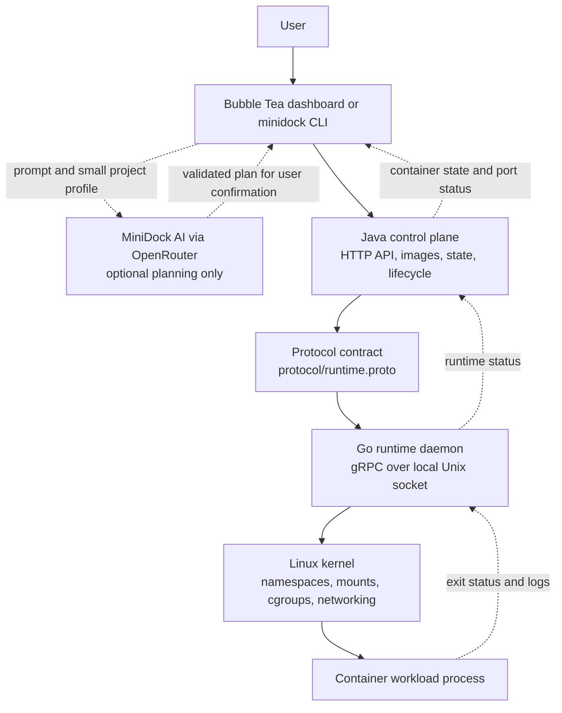

# Build an AI Mini-Docker from Scratch with Go and Java

<p align="center">
  <strong>A hands-on guide to a small Linux image builder, container runtime, and AI-assisted control plane</strong>
</p>

<p align="center">
  
  
  
  
</p>

> **Who this article is for:** people who know Docker and want to understand
> how a small container system fits together, and people new to containers
> who want to follow a real project from a user request to a Linux process.

This article explains how **MiniDock** is designed: a learning-focused Linux
app builder and container runner with a **Go runtime**, a **Java control
plane**, and **MiniDock AI**, its optional assistant. It maps the components,
explains the Linux pieces in everyday language, and includes annotated examples
for building a similar system.

---

## Start with the mental model

If you know Docker, the names will sound familiar. The roles are similar, but
MiniDock is intentionally much smaller and is not compatible with Docker's
image format or command-line contract.

| MiniDock concept | Plain-language meaning | Docker analogy |
| --- | --- | --- |
| **Project** | Your source code and build files | Build context |
| **Image** | A local Linux root filesystem plus MiniDock startup metadata | An image, conceptually |
| **Container** | One isolated process started from an image | A container, conceptually |
| **Go runtime** | Creates namespaces, filesystem view, limits, networking, and process | Part of a container engine/runtime |
| **Java control plane** | HTTP API, image store, container records, and runtime coordination | Part of a daemon/control plane |
| **MiniDock AI** | Discusses goals and suggests a supported local action | A constrained assistant, not an executor |

An **image is the packaged starting point**. A **container is one launch of
that starting point**. One image can start multiple containers, each with its
own process identity and lifecycle.

### What this project is—and isn't

MiniDock is a compact local system for learning how image packaging and Linux
process isolation fit together. It supports a few explicit source-build
adapters: Vite, Go main packages, and Maven executable Java projects. It can
also stage an already-prepared `.tar` or `.tar.gz` Linux root filesystem.

It is **not** a Docker clone or a general-purpose production runtime. It does
not build arbitrary Dockerfiles, pull from Docker Hub, or run Docker/OCI images.
Its bundles target Linux and MiniDock's supported layout. Windows and macOS
need a Linux virtual machine to run this runtime.

---

## The whole system at a glance

The system is split so the user interface, HTTP API, and kernel-facing setup
each have a clear home:



### Who does what?

1. **Dashboard or CLI:** turns user choices into requests and displays images,
   state, logs, build progress, and app port mappings.
2. **MiniDock AI:** interprets a request and helps choose from supported
   actions. It has no permission to run shell commands.
3. **Java control plane:** validates requests, stages archives, extracts root
   filesystems, reads startup metadata, tracks lifecycle, and asks Go to launch
   or stop a workload.
4. **Go daemon:** validates runtime settings and performs Linux-specific
   process setup and monitoring.
5. **Linux kernel:** enforces namespaces, mounts, cgroups, process IDs, and
   network interfaces.

The dashboard talks to Java over HTTP, normally bound to `127.0.0.1`. Java
talks to Go over **gRPC on a local Unix domain socket**. The shared message
contract is [`protocol/runtime.proto`](protocol/runtime.proto).

## Table of contents

- [What you need](#-what-you-need)
- [Plan the boundaries](#-plan-the-boundaries-before-coding)
- [Repository layout](#-lay-out-the-repository)
- [Java–Go protocol](#-define-the-javago-protocol)
- [Images and build adapters](#-build-and-store-an-image)
- [Java control plane](#-create-the-java-control-plane)
- [Go runtime](#-create-the-go-runtime)
- [Linux isolation](#-understand-linux-isolation)
- [Networking and ports](#-add-networking-and-visible-ports)
- [MiniDock AI](#-add-minidock-ai-safely)
- [Dashboard](#-make-the-dashboard-helpful)
- [A complete build and run](#-trace-a-complete-build-and-run)
- [Run this repository](#-build-start-and-use-this-repository)
- [Debugging](#-debug-the-failures-people-actually-hit)
- [Security and portability](#-know-the-security-and-portability-limits)
- [Build your own in stages](#-a-sensible-order-for-building-your-own)

---

## What you need

MiniDock runs on **Linux**, because its isolation model uses Linux kernel
features. For development, install:

- Go (the version selected by `go-runtime/go.mod`).
- Java 21 and the repository's Maven wrapper.
- `make`, Python 3, `curl`, and `sudo` for the root `run.sh` workflow.
- For Vite builds: compatible Node.js and npm, plus Go for the small static
  server packaged with the site.
- For Go builds: the Go toolchain and module dependencies.
- For Maven builds: Maven or `mvnw`, a JDK with `jlink`, and project
  dependencies.
- For container networking: `iproute2`, `nsenter`, `iptables`, and permission
  to configure bridge/veth networking.
- For CPU or memory limits: a **writable delegated cgroups v2 subtree** with
  the needed controllers enabled.
- For AI calls: an OpenRouter API key. AI is optional; local building and
  running do not inherently need a model key.

Inspect your host:

```sh
uname -a
go version
java -version
python3 --version
cat /sys/fs/cgroup/cgroup.controllers
command -v ip nsenter iptables
```

Seeing `cpu memory pids` means controllers are visible there; it does **not**
prove MiniDock can write to its chosen subtree. Delegation and host security
policy still matter.

> **Learn on a disposable Linux machine or VM.** Network setup changes host
> interfaces and forwarding/firewall state. Do not experiment with hostile
> workloads or valuable data.

---

## Plan the boundaries before coding

A container engine touches the operating system. Putting all responsibilities
in one program makes failures hard to understand and cleanup easy to forget.
MiniDock draws three practical boundaries:

```text
User decisions              Java management             Linux process setup
dashboard / CLI       →      HTTP + lifecycle       →     Go + kernel APIs
```

### Why Java and Go together?

- **Java** owns the HTTP API, image storage, archive extraction, persistent
  records, validation, and orchestration.
- **Go** provides a compact runtime binary and direct access to Linux process,
  namespace, filesystem, and networking operations.
- **Protocol Buffers/gRPC** make their boundary explicit and typed.
- **Bubble Tea** presents a terminal UI without coupling UI state to kernel
  setup.
- **Python build adapters** inspect project manifests and invoke local build
  tools. They package artifacts; Java and Go own the long-running services.

The language split is a choice, not a requirement. The useful principle is to
keep API/state management separate from privileged process setup.

## Lay out the repository

One workable project tree is:

```text
mini-dock/
├── run.sh                         # build and launch the local system
├── Makefile                       # repeatable build and verification commands
├── protocol/runtime.proto         # Java–Go API contract
├── scripts/
│   ├── minidock_build.py          # fixed local source-build adapters
│   ├── minidock_ask.py            # AI response validation for `ask`
│   └── minidock_ask_build.py      # project chat/build planning
├── go-runtime/
│   ├── cmd/minidockd/             # runtime daemon
│   ├── cmd/minidock-ui/           # Bubble Tea dashboard
│   ├── internal/container/       # runtime lifecycle coordination
│   ├── internal/isolation/       # namespace and child setup
│   ├── internal/rootfs/          # mounts and pivot_root
│   ├── internal/cgroups/         # cgroups v2
│   ├── internal/network/         # bridge and veth setup
│   ├── internal/transport/       # gRPC server and runtime sessions
│   └── gen/runtime/v1/           # generated protobuf bindings
└── java-control-plane/src/main/java/dev/minidocker/
    ├── api/                       # HTTP endpoints and JSON types
    ├── image/                     # image store and safe extraction
    ├── runtime/                   # Go gRPC client
    ├── service/                   # orchestration and port forwarding
    └── state/                     # lifecycle and persistence
```

Keep generated code generated. Edit the `.proto` source, then regenerate both
language bindings instead of hand-editing Go or Java generated classes.

---

## Define the Java–Go protocol

The protocol is the agreement between control plane and runtime. It describes
runtime operations—not dashboard buttons—so the interface can change without
changing how Go starts a process.

MiniDock's contract covers starting a workload, waiting for exit, stopping it,
listing live processes after a restart, retrieving bounded logs, and streaming
an attached terminal:

```protobuf
syntax = "proto3";
package minidock.runtime.v1;

service RuntimeService {
  rpc Start(RunRequest) returns (StartResponse);
  rpc Wait(WaitRequest) returns (RunResponse);
  rpc Stop(StopRequest) returns (StopResponse);
  rpc ListActiveContainers(ListActiveContainersRequest)
      returns (ListActiveContainersResponse);
  rpc GetContainerLogs(GetContainerLogsRequest)
      returns (GetContainerLogsResponse);
  rpc Attach(stream AttachInput) returns (stream AttachOutput);
}

message RunRequest {
  string id = 1;
  string rootfs = 2;
  repeated string command = 3; // argv, not a shell command string
  repeated string env = 4;     // KEY=value entries
  string hostname = 5;
  uint64 memory_max = 6;
  uint64 cpu_quota = 7;
  uint64 cpu_period = 8;
  bool network = 9;
  string network_ip = 10;
  bool attach = 11;
  bool tty = 12;
  string log_path = 13;
}
```

Field numbers are part of the wire format. Don't reuse a removed field number
for a new meaning. Add fields with new numbers and consider whether old Go and
Java binaries may still communicate with the updated service.

The Go module includes generated bindings in `go-runtime/gen/runtime/v1`.
Maven's protobuf plugin generates Java messages and gRPC stubs from
`protocol/runtime.proto`. A typical Go generation command (with compatible
`protoc-gen-go` plugins installed) is:

```sh
protoc --proto_path=protocol \
  --go_out=go-runtime/gen \
  --go_opt=module=mini-docker/go-runtime \
  --go-grpc_out=go-runtime/gen \
  --go-grpc_opt=module=mini-docker/go-runtime \
  protocol/runtime.proto
```

Use the exact module paths and plugin versions declared by your module. The
contract keeps Java and Go from silently disagreeing about request fields.

---

## Build and store an image

### What MiniDock calls an image

For this project, an image is a `.tar` or `.tar.gz` containing a Linux root
filesystem. It is not a Docker layer stack. A simple rootfs might look like:

```text
rootfs/
├── usr/bin/my-service
├── etc/minidock/image.json
└── ...other files the application needs...
```

The optional metadata records a startup argv and the app's container port:

```json
{
  "command": ["/usr/bin/my-service", "--listen", "0.0.0.0:8080"],
  "container_port": 8080
}
```

This file lives at `/etc/minidock/image.json` **inside the rootfs**. The
command is an argument array, avoiding shell parsing. `container_port` is
where the app listens inside the container; Java can publish it on a host
localhost port later.

### Build adapters

The adapter in `scripts/minidock_build.py` detects a supported project and
performs known steps. It does not accept commands written by the model. A
Vite adapter, for example, runs the project's build script, packages `dist/`
with MiniDock's static server, writes image metadata, and creates a tar.

```python
def build_project(project_dir, output_archive):
    kind = detect_supported_project(project_dir)
    if kind != "vite":
        raise UnsupportedProject("no MiniDock adapter for this project")

    run_vite_build(project_dir)  # a local, reviewed adapter step
    rootfs = make_temporary_rootfs()
    copy_static_output(project_dir, rootfs)
    copy_minidock_web_server(rootfs)
    write_metadata(rootfs, [
        "/usr/bin/minidock-web",
        "--root", "/usr/share/minidock/www",
        "--listen", "0.0.0.0:8080",
    ], container_port=8080)
    make_rootfs_archive(rootfs, output_archive)
```

This is illustrative; real code should pass argv arrays to subprocesses and
validate paths. Project build tools run on the host as the builder user.

| Adapter | Build result | What goes in the rootfs |
| --- | --- | --- |
| Vite | Static frontend bundle | Static files and MiniDock web server |
| Go | Linux executable | Application binary and metadata |
| Maven Java | Executable JAR and `jlink` runtime | JAR, minimized Java runtime, required libraries |
| Rootfs archive | No source compilation | The archive supplied by the user |

### Store images safely

Java receives a multipart archive and simple image name. The store validates
the name and extension, copies to a temporary file in the image directory,
then renames it to the final filename. A same-filesystem atomic move avoids
showing a partly uploaded image.

```java
@PostMapping(consumes = MediaType.MULTIPART_FORM_DATA_VALUE)
ResponseEntity<?> stage(@RequestParam String name,
                        @RequestParam MultipartFile archive) throws IOException {
    validateSimpleImageName(name);
    validateTarArchiveName(archive.getOriginalFilename());
    Path temporary = copyToTemporaryFile(archive);
    Path stored = imageStore.registerArchive(name, temporary);
    return ResponseEntity.ok(Map.of("name", name, "path", stored.toString()));
}
```

Safe extraction matters just as much as upload validation. Archives may contain
absolute paths, `..` traversal, unsafe links, enormous expanded data, or
unsupported entry types. Resolve each entry under a dedicated destination,
reject escapes and unsafe parents, cap expanded bytes, and delete partial
extractions after failure. MiniDock's extractor caps expanded data at 8 GiB.

---

## Create the Java control plane

Java is the **manager**. It owns the HTTP workflow and persistent view of
images and containers. It should not implement `pivot_root` or Linux bridge
setup itself; it delegates those operations to Go.

### Expose a small HTTP API

| Request | Purpose |
| --- | --- |
| `GET /api/v1/images` | List staged images |
| `POST /api/v1/images` | Stage a `.tar` or `.tar.gz` rootfs |
| `POST /api/v1/containers` | Create and start a container |
| `GET /api/v1/containers` | List active containers |
| `GET /api/v1/containers?all=true` | Include finished records |
| `GET /api/v1/containers/{id}` | Inspect a container |
| `GET /api/v1/containers/{id}/logs` | Read a bounded log range |
| `DELETE /api/v1/containers/{id}` | Request stop |
| `DELETE /api/v1/containers/{id}/record` | Delete a finished record and files |

Bind this local learning tool to `127.0.0.1` by default. The API has no user
authentication in this project; loopback binding is a boundary, not a
replacement for authentication if remote access is ever added.

### Orchestrate a container start

The core service flow is approximately:

```java
ContainerView create(CreateContainerRequest request) throws IOException {
    Path archive = images.resolveArchive(request.image());
    String id = newContainerId();
    Path containerDir = containersDirectory.resolve(id);
    Path rootfs = containerDir.resolve("rootfs");

    extractor.extract(archive, rootfs);
    ImageRuntimeConfig image = readImageMetadata(rootfs);
    List<String> command = request.command().isEmpty()
            ? image.command()
            : request.command();

    ContainerRecord record = registry.create(id, request.image(), command);
    RuntimeGateway.Execution execution = goRuntime.run(
            toRunConfig(id, rootfs, command, request));
    record.markRunning(execution.pid());
    watchCompletion(execution, record, containerDir);
    return record.view();
}
```

The real method also validates input, allocates a network IP when requested,
opens a port forward if there is app-port metadata, persists state, and cleans
up after startup failure. Keep failure handling explicit: a failed mount or
runtime start must not leave a record claiming success.

### Track lifecycle and recovery

Java records the ID, image, argv, PID, network IP, status, timestamps, exit
code, error, and optional port mapping. Persist snapshots atomically. On Java
startup, compare saved records with Go's active-session list:

- A matching process can be reconnected and monitored.
- A saved record without a live runtime session can be marked stale/exited.
- A live Go process without a Java record can be represented as recovered.

This is local reconciliation, not a distributed database or a promise that a
container survives daemon failure. Never trust a saved PID alone; compare it
with the runtime's active session and process identity.

---

## Create the Go runtime

The Go daemon asks the Linux kernel to create and manage the workload. It
listens on a Unix socket, not a public TCP port. Java sends a `RunRequest`; Go
validates it and performs setup.

### Validate before changing host state

Reject malformed configuration early:

```go
func (c Config) Validate() error {
    if c.ID == "" || c.RootFS == "" || !filepath.IsAbs(c.RootFS) {
        return errors.New("container ID and absolute rootfs are required")
    }
    if len(c.Command) == 0 || c.Command[0] == "" {
        return errors.New("an executable is required")
    }
    if c.TTY && !c.Attach {
        return errors.New("TTY mode requires an attached session")
    }
    return nil
}
```

The actual validator also restricts IDs, rejects NUL bytes, validates
`KEY=value` entries, requires CPU quota and period together, and keeps
container IPs within the configured subnet. These values cross a process and
privilege boundary, so validation is not optional.

### Start paused, configure, then release

If the child executes immediately, it can race ahead before its cgroup or
network is ready. MiniDock starts it paused, attaches limits and networking,
then releases it:

```go
func runStarted(ctx context.Context, cfg Config, backend Backend) (runErr error) {
    child, err := backend.StartPaused(ctx, cfg)
    if err != nil { return fmt.Errorf("start isolated child: %w", err) }

    cleanups := []func() error{child.Close}
    defer func() {
        for i := len(cleanups) - 1; i >= 0; i-- {
            runErr = errors.Join(runErr, cleanups[i]())
        }
    }()

    cgroupCleanup, err := backend.AttachCgroup(ctx, cfg, child.PID())
    if err != nil { return fmt.Errorf("attach cgroup: %w", err) }
    if cgroupCleanup != nil { cleanups = append(cleanups, cgroupCleanup) }

    networkCleanup, err := backend.ConfigureNetwork(ctx, cfg, child.PID())
    if err != nil { return fmt.Errorf("configure network: %w", err) }
    if networkCleanup != nil { cleanups = append(cleanups, networkCleanup) }

    if err := child.Exec(ctx, cfg); err != nil { return err }
    return child.Wait()
}
```

The production lifecycle accumulates cleanup handlers and runs them in
reverse setup order. Normal exit, a stop request, and setup failure all need
cleanup.

### Acknowledge startup separately from exit

The `Start` RPC waits until namespace/rootfs setup is complete and the child
acknowledges that it is ready to call `execve`. It returns the host PID and
network IP. The workload may still fail at exec or exit immediately afterward:
a successful start response is not proof that an HTTP app is healthy. A
separate `Wait` RPC returns its eventual exit code.

Go also implements stop, active-session listing, logs, and attached-terminal
streaming. Detached output goes to a bounded per-container log; attached
sessions use a PTY/stream path.

---

## Understand Linux isolation

MiniDock uses kernel features to change what the process can see and which
host resources it can use. These are not small virtual machines: the workload
is a Linux process on the same host kernel.

### Namespaces

This runtime creates user, PID, mount, network, UTS, and IPC namespaces:

| Namespace | What changes for the process |
| --- | --- |
| User | Maps container IDs to host IDs; container UID 0 is not automatically host root |
| PID | Gives it a separate process ID view |
| Mount | Gives it a separately arranged filesystem mount view |
| Network | Gives it separate interfaces and routes |
| UTS | Allows a separate hostname |
| IPC | Separates selected inter-process communication objects |

MiniDock maps container root to the invoking host user's UID/GID where
configured. The child executes an already-open runtime descriptor through
`/proc/self/fd`; this avoids a second executable path lookup through a
restricted home directory under the mapped identity.

### Filesystem and `pivot_root`

Java extracts the archive into a per-container directory. The Go child
prepares mounts, a minimal `/dev`, `/proc`, and a private mount view; pivots
into the extracted rootfs; detaches the old root; sets `no_new_privs`; then
executes the requested argv.

`pivot_root` changes the process's filesystem root. Merely changing the
working directory would leave the host's original filesystem tree reachable.
The operation needs an appropriate mount point in a private mount namespace.
If setup fails half-way through, the runtime must unwind what it created.

This learning runtime does **not** provide a complete OCI security profile,
seccomp policy, or full capability-management system. Treat workloads as
trusted local applications.

### Cgroups v2

Namespaces control visibility; **cgroups control resource accounting and
limits**. When requested, Go creates a per-container group, writes controls,
and moves the host PID into it. For example:

```text
memory.max = 268435456
cpu.max    = 50000 100000
cgroup.procs = <host pid>
```

The first line caps memory at 256 MiB. The CPU line permits half of one CPU
over a 100 ms period. The host must delegate a writable subtree; seeing
controller names alone is not sufficient.

### User namespaces and host identity

UID 0 **inside** a user namespace can map to an ordinary host UID. This
reduces that identity's authority outside its namespace, but does not make
arbitrary code harmless. File ownership, directory traversal, mounts, and
host capability rules still affect setup.

---

## Add networking and visible ports

Networking has two separate jobs: give the process an interface inside its
network namespace, and optionally make an app reachable from the host.

MiniDock creates a host bridge (default `minidock0`) and a veth pair. One end
stays on the bridge; the other moves into the container namespace as `eth0`.
The runtime assigns an address from `10.0.0.0/24` and a route through the
bridge gateway. Host forwarding and owned firewall/NAT rules support outbound
traffic where host policy permits it.

### Container port versus host port

Suppose an app listens on `0.0.0.0:8080` inside its container. MiniDock can
bind an available loopback port and forward it:

```text
Browser on this host
  http://127.0.0.1:49152
             │ MiniDock TCP forward
             ▼
  container 10.0.0.2:8080 → application
```

The host port is selected by asking the kernel to bind port `0`, which returns
an available port. The bound socket stays open for the forwarder's lifetime,
so another listener cannot take it. The dashboard displays both sides and
reports readiness only after an HTTP response passes through that forward. A
running process alone is not proof that a web app is ready.

The forwarder binds loopback only; it is for use on the MiniDock host, not the
LAN. The application must bind to a container interface, usually `0.0.0.0`.
Binding only to container `127.0.0.1` will not accept traffic arriving over
`eth0`.

---

## Add MiniDock AI safely

MiniDock AI assists the user; the runtime stays deterministic. This is the
design choice that keeps the model from becoming a remote shell.

### The safe flow

```text
User describes a goal
       ↓
MiniDock sends a limited project profile or staged image list to OpenRouter
       ↓
Model returns a structured suggestion
       ↓
MiniDock parses and validates every field
       ↓
User reviews and confirms
       ↓
Fixed local adapter or ordinary container API performs the operation
```

Build planning needs only selected manifest/dependency facts and the local
adapter choices—not source code or `.env` values. The `ask` flow sends the
prompt and names of images already staged locally. It must select an available
image and produce an argv array.

### Never turn model text into shell input

Do not accept a model-generated shell line such as `curl ... | sudo sh` and
execute it. Request a small structured plan instead:

```json
{
  "image": "frontend-app",
  "command": ["/usr/bin/minidock-web", "--listen", "0.0.0.0:8080"],
  "memory_limit": "128M",
  "cpu_limit": null,
  "network": true
}
```

Validate it as untrusted input:

```python
def validate_plan(plan, staged_images):
    if plan["image"] not in staged_images:
        raise ValueError("AI selected an image that is not staged")
    if not isinstance(plan["command"], list) or not plan["command"]:
        raise ValueError("command must be a non-empty argv array")
    if not all(isinstance(arg, str) and "\0" not in arg
               for arg in plan["command"]):
        raise ValueError("invalid command argument")
    validate_memory_and_cpu(plan)
    return plan
```

Pass argv to the regular API; never interpolate it into `sh -c`. Check the
image is staged and require user confirmation. For image building, the model
chooses among fixed adapter IDs; local adapter code performs the build.

### OpenRouter configuration and privacy

Keep the key out of source control and image contents. This repository's
`bin/minidock` loads AI variables from the root `.env` without overriding
values already exported in the shell:

```dotenv
OPENROUTER_API_KEY=your_key_here
OPENROUTER_MODEL=openrouter/auto
```

Ignore `.env` in Git and restrict its permissions:

```sh
chmod 600 .env
```

AI requests leave the machine to reach OpenRouter. Don't include passwords,
tokens, private environment values, or confidential source in prompts. The
project profiler sends selected manifest/dependency information, not source
files or project `.env` values. Check your model and spending settings with
your OpenRouter account.

The assistant's system prompt should describe MiniDock's actual adapters and
runtime limits. Parsers should restrict schema, sizes, and valid values, and
handle timeouts/provider errors. The model suggests; local code decides which
operations exist and executes them.

---

## Make the dashboard helpful

A CLI is useful, but users should not need to memorize low-level commands just
to launch an image. Present a few clear screens:

```text
Home
├── Images → choose an image → start it
├── Containers → inspect, logs, stop, delete finished record
└── Build image with AI → chat → review recipe → confirm → show progress
```

With Bubble Tea, the model is state plus an update function. A simplified
example:

```go
type Model struct {
    screen     Screen
    images     []Image
    containers []Container
    selected   int
    notice     string
    busy       bool
}

func (m Model) Update(msg tea.Msg) (tea.Model, tea.Cmd) {
    switch msg := msg.(type) {
    case tea.KeyMsg:
        switch msg.String() {
        case "up", "k":
            m.selected--
        case "down", "j":
            m.selected++
        case "enter":
            return m, m.startSelectedImage()
        }
    case ContainerStarted:
        m.notice = "Container started: " + msg.ID
        return m, m.refreshOverview()
    }
    return m, nil
}
```

This is a sketch, not a drop-in implementation. Do not block the UI while
HTTP, OpenRouter, or builds run. Use Bubble Tea commands, send results back as
messages, show build logs, and report errors plainly. Keep the app port and
host port as separate fields in the view model. Color can distinguish the
user, MiniDock AI, ready/starting/error states; preserve plain output for
terminals and scripts that do not use color.

---

## Trace a complete build and run

Follow a Vite frontend from source folder to browser:

1. **The user describes the goal.** The dashboard profiles the folder and asks
   AI to explain it or rank supported recipes. If no adapter matches, it says
   so instead of claiming to build arbitrary projects.
2. **The user confirms a recipe.** The fixed Vite adapter runs the host build,
   packages `dist/` and MiniDock's static server, writes
   `/etc/minidock/image.json`, and creates a rootfs tar. Model text is not run.
3. **Java stages the image.** The client uploads it to `POST /api/v1/images`;
   Java validates and stores it, for example at
   `~/.local/share/minidock/images/frontend-app.tar.gz`. Staging does not
   start a container.
4. **The user selects the image.** Java extracts it into a unique rootfs,
   reads startup metadata, assigns ID/IP, records state, and sends Go `Start`.
5. **Go prepares Linux.** The child enters namespaces and waits for the
   parent's setup handshake. Go applies requested cgroups and networking,
   then lets the child mount/pivot to the rootfs and execute the app.
6. **Java publishes the app port.** If metadata says `8080`, Java binds an
   available localhost port (perhaps `49152`) and forwards to the container.
   The dashboard shows the mapping and waits for an HTTP response through it.
7. **The user operates the container.** Java records status and watches Go's
   exit result. The user can refresh, inspect logs, stop it, and permanently
   delete a finished container record. The image remains staged.

---

## Build, start, and use this repository

From the repository root:

```sh
make build
./run.sh
```

`run.sh` builds the Go and Java programs, starts the Go daemon and Java API,
waits for readiness, and opens the Bubble Tea dashboard. It does **not** build
your application image or start a container automatically. The script asks
for sudo authentication because it launches the Go daemon with the host
permissions needed for the configured Linux operations.

Build from another terminal or use the dashboard's AI conversation:

```sh
bin/minidock build -t frontend-app frontend/
```

Common commands:

```sh
bin/minidock images                 # list staged images
bin/minidock ps                     # active containers
bin/minidock ps --all               # include finished containers
bin/minidock logs CONTAINER_ID       # read output
bin/minidock stop CONTAINER_ID      # request stop
bin/minidock rm CONTAINER_ID        # delete a finished container permanently
```

Manual start syntax:

```sh
bin/minidock run [-m MEMORY] [-c CPU] [-p CONTAINER_PORT] \
  [-d|--detach] [--network|--no-network] IMAGE COMMAND [ARG...]
```

Use the dashboard to launch an image using embedded startup metadata. Use CLI
`run` when you need to supply the command directly. Attached runs connect
terminal input/output; `-d` runs in the background and writes bounded logs.

### Verification without risking the host

The ordinary project checks and the real-kernel check have different purposes:

```sh
make test
```

`make test` runs the normal Go, Java, and AI-related checks. The privileged
host path is separate:

```sh
sudo make e2e
```

`make e2e` requires a real delegated cgroups v2 subtree in
`MINIDOCK_CGROUP_ROOT`, the networking tools, and `busybox`. It creates real
namespaces, mounts, a bridge/veth pair, and firewall/forwarding state. It
refuses to run if `minidock0` or a route for `10.0.0.0/24` already exists.
Use a disposable Linux host and configure the delegated subtree before
running it; do not paste a placeholder path. A successful run verifies only
the exercised host and kernel policy.

### Data locations and environment

Defaults are beneath `~/.local/share/minidock/`:

```text
images/       staged image archives
containers/   extracted roots and logs
state.json    Java lifecycle snapshot
```

| Variable | Purpose | Default |
| --- | --- | --- |
| `MINIDOCK_API_PORT` | Java HTTP API port | `8080` |
| `MINIDOCK_SOCKET` | Java–Go Unix socket | `/tmp/minidock-runtime.sock` |
| `MINIDOCK_IMAGES_DIR` | Image archive directory | `~/.local/share/minidock/images` |
| `MINIDOCK_CONTAINERS_DIR` | Extracted roots and logs | `~/.local/share/minidock/containers` |
| `MINIDOCK_STATE_FILE` | Java lifecycle snapshot | `~/.local/share/minidock/state.json` |
| `MINIDOCK_CGROUP_ROOT` | Delegated cgroups v2 subtree | Host-dependent |

Java and Go must agree on the socket and container directory. Both processes
also need access to those locations.

---

## Debug the failures people actually hit

### “Permission denied” starting the runtime executable

Check where the binary lives and how it is launched. A namespace child may not
traverse the daemon's original home path after UID/GID mapping. Keeping an
already-open executable descriptor and executing through `/proc/self/fd`
avoids a second lookup through the restricted path.

### “EOF” during child setup

EOF often means the child exited before sending its setup acknowledgement.
Preserve and inspect logs, then report the exact failing step: namespace,
mount, `pivot_root`, cgroup, network, or exec. Replace an opaque EOF with the
child's specific error wherever possible.

### Cgroups are visible but limits fail

Check that the configured path is a **dedicated writable delegated subtree**,
not `/sys/fs/cgroup` or a placeholder. Inspect `cgroup.controllers`,
`cgroup.subtree_control`, and permissions. Visible controller names do not
prove writes are allowed at MiniDock's configured path.

### Container is RUNNING but the app is unavailable

RUNNING means the process started; it does not mean an HTTP server is ready.
Check `bin/minidock logs CONTAINER_ID`, verify command and bind address, and
inspect both sides of the port mapping. Apps requiring `DATABASE_URL` may exit
if it is not configured. MiniDock does not silently copy project `.env` files
into images or containers.

### No command or app port was detected

Hand-made archives may not contain `/etc/minidock/image.json`. MiniDock can
make limited safe guesses for known layouts, but should not invent an
entrypoint for arbitrary files. Rebuild with a supported adapter or pass the
CLI command and optional `-p` port.

### Vite reports an unsupported Node.js version

Install a Node.js version supported by that project's Vite version and retry.
The project build runs on the host; MiniDock does not hide the toolchain
requirement by installing Node inside the runtime container.

### AI does not answer

Check `.env`, the OpenRouter key, network access to OpenRouter, and whether the
configured model is available to your account. AI planning is an optional
online feature separate from the local runtime.

### Port mapping remains “checking”

The host port is assigned, but the HTTP probe has not received a response
through the forward. Check logs, app port, and bind address. A TCP-only service
will not pass an HTTP check; it may still be usable by a TCP client, but should
not be labeled as a ready HTTP URL.

---

## Know the security and portability limits

MiniDock is a learning runtime, not a hardened multi-tenant boundary.
Namespaces and cgroups provide useful isolation and resource controls, but it
does not implement a complete seccomp profile, capability policy, image
signing, or OCI validation. Do not run untrusted workloads or expose the
unauthenticated control API to a network.

- A MiniDock image is a local rootfs bundle with MiniDock metadata.
- It is not automatically runnable by Docker or another engine.
- The runtime needs a compatible Linux kernel and userspace behavior.
- Bundled Java libraries and architecture must match the Linux target.
- Windows and macOS need a Linux VM for this runtime.

Keep the project small and honest about these boundaries. The goal is to
understand the core local workflow, not to reproduce every Docker feature.

---

## A sensible order for building your own

Starting from an empty repository, work in checkpoints:

1. **Define scope:** Linux only, one archive format, one command model, and
   explicit workload types.
2. **Run one ordinary process:** validate argv, wait for it, collect its exit
   code, and get cleanup right.
3. **Add the rootfs workflow:** stage and safely extract an archive; reject
   traversal and malicious links.
4. **Write the protocol:** define start/wait/stop and logs in one `.proto`;
   generate both language bindings.
5. **Build the Go daemon:** listen on a permission-controlled Unix socket and
   manage process lifecycle before adding isolation.
6. **Build the Java API:** add image endpoints, validation, state records, and
   the gRPC gateway.
7. **Add namespaces incrementally:** user/PID/mount first, then UTS/IPC/network
   as the feature requires.
8. **Add a setup handshake:** hold the child until the parent attaches limits
   and configures networking.
9. **Add cgroups and networking explicitly:** optional features, host checks,
   clear errors, reliable cleanup.
10. **Add logs, stop, and recovery:** cover success, failed setup, stop races,
    and service restarts.
11. **Add image adapters:** each adapter should be fixed, inspectable, and
    responsible for startup metadata.
12. **Add port publishing:** bind a free host port and distinguish process
    start from HTTP readiness.
13. **Add AI last:** let it choose supported actions; validate and require
    confirmation. Never grant unrestricted command execution.
14. **Add the dashboard:** make progress, logs, ports, state, and errors
    visible.
15. **Verify on a disposable Linux host:** mocks cannot prove that the host
    permits namespaces, mounts, cgroup delegation, or network changes.

The most useful engineering habit is to make every boundary observable. Show
the selected image, actual argv, lifecycle state, host and container ports,
logs, and the specific step that failed.

---

<p align="center"><strong>MiniDock · Go runtime · Java control plane · MiniDock AI</strong><br>
<em>Small enough to study. Real enough to teach the moving parts.</em></p>
